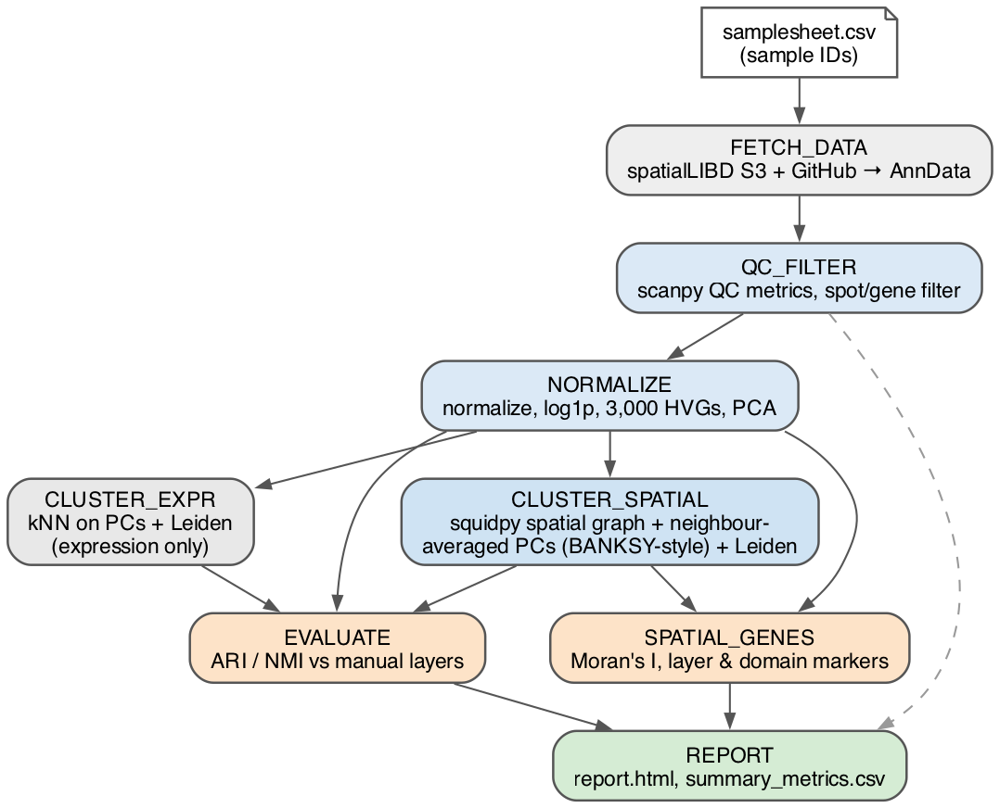
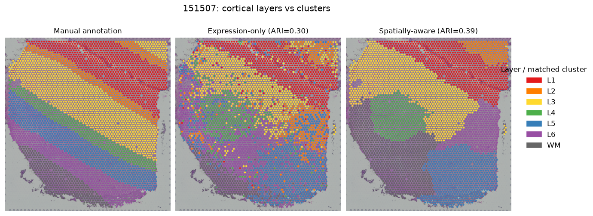

# spPipe: does spatial information help recover cortical layers?

A Nextflow pipeline for 10x Visium spatial transcriptomics of the human dorsolateral prefrontal cortex (DLPFC). It compares **expression-only** clustering with **spatially-aware** clustering against expert-annotated cortical layers, and reports which one recovers the layers better.

```bash
nextflow run main.nf -profile conda        # or: -profile docker (see Step 3)
```

Runtime: ~3 minutes for 2 samples on a laptop (plus a one-time environment build). Data (~30 MB) is downloaded automatically.

---

## Contents

1. [Background](#1-background)
2. [Rationale for the design](#2-rationale-for-the-design)
3. [Pipeline DAG and stages](#3-pipeline-dag-and-stages)
4. [Data](#4-data)
5. [Dependencies](#5-dependencies)
6. [Installation and usage](#6-installation-and-usage)
7. [Expected results](#7-expected-results)
8. [Directory structure](#8-directory-structure)
9. [References](#9-references)

---

## 1. Background

The neocortex is organised into **six layers (L1–L6)** over **white matter (WM)**. Each layer has its own mix of neuron and glia types and its own connections, and layer-specific gene expression is altered in disorders such as schizophrenia and autism (Maynard et al., 2021). Finding layers from gene expression is therefore a basic first step in studying the cortex.

**Spatial transcriptomics** (10x Visium) measures genome-wide expression in ~4,000 spots of 55 µm on a tissue section and records where each spot is. A common way to find tissue regions is to borrow the single-cell workflow: cluster spots by expression alone (PCA → kNN graph → Leiden). This treats every spot as **independent** and throws away its location. But layers are **spatially continuous bands**: a spot is very likely in the same layer as its neighbours. Individual Visium spots are also noisy (low counts, mixtures of several cells), so expression-only clusters tend to be speckled and to follow technical gradients rather than anatomy.

**Biological question:** *Does adding spatial-neighbourhood information to clustering recover the layers of the human DLPFC better than expression-only clustering?*

This is testable because the spatialLIBD dataset (Maynard et al., 2021) has every spot **manually annotated** with its layer by experts. The pipeline scores each method against this annotation with the **adjusted Rand index (ARI)**, so the comparison is quantitative instead of judged by eye. The workflow follows the spatial chapters of [single-cell best practices](https://www.sc-best-practices.org/spatial/neighborhood.html) (Heumos et al., 2023).

## 2. Rationale for the design

| Choice | Why |
| --- | --- |
| **Two methods, identical input** | Both methods use the same QC, normalisation, highly variable genes and principal components (PCs). The only difference is whether neighbouring spots are used, so any change in ARI is caused by the spatial information. |
| **Fixed number of clusters (7)** | Leiden's resolution is tuned automatically (binary search) to give exactly 7 clusters = L1–L6 + WM for both methods. Otherwise a method could look better or worse just by producing more or fewer clusters. |
| **BANKSY-style spatial method** | For each spot, the PCs of its spatial neighbours (2 rings of the Visium hexagonal grid, ~18 spots) are averaged and concatenated with its own PCs, weighted by λ (Singhal et al., 2024). λ = 0 is exactly the expression-only method, so the two are directly comparable. It is simple to explain, needs only scanpy + squidpy (no GPU / PyTorch), and runs in seconds on arm64 and amd64. |
| **Scored on manual labels with ARI and NMI** | ARI (0 = random, 1 = perfect) is the standard metric for this dataset, so numbers can be compared with the literature. NMI is reported as a second view. Spots without a label are excluded from scoring. |
| **Spatially variable genes (Moran's I) and markers** | Checks the biology behind the clusters: known layer markers (e.g. *MOBP* for WM, *PCP4* for L5) and data-driven spatially patterned genes. |
| **Defaults chosen by a sensitivity sweep** | 20 PCs, λ = 0.8, 2 rings were chosen from a sweep over PCs (10/20/30), λ (0.5/0.8), rings (1/2/3) and gene scaling on both samples. **All 36 spatial settings beat all 6 expression-only settings**, so the conclusion does not depend on the exact parameters. The defaults sit in a stable region rather than at the single best value. |
| **Reproducibility** | Pinned package versions (`envs/environment.yml`), the same environment in conda and Docker, fixed random seeds, single-threaded numerical libraries. |
| **Lightweight** | 2 samples by default (~30 MB download, <1 GB RAM per task, ~3 min). More samples can be added to the samplesheet. |

## 3. Pipeline DAG and stages



*Process-level DAG. The DAG generated by Nextflow from the code (`-with-dag`) is in [docs/dag_nextflow.png](docs/dag_nextflow.png).*

Each sample runs through stages 0–5 independently (in parallel); stage 6 combines all samples.

| # | Process | What it does | Main tools | Key outputs |
| -- | --- | --- | --- | --- |
| 0 | `FETCH_DATA` | Downloads the count matrix, spot coordinates, H&E image and manual labels; builds an AnnData object | anndata, scanpy | `{id}_raw.h5ad` (not published) |
| 1 | `QC_FILTER` | Per-spot QC (counts, genes, % mitochondrial); removes spots with <500 counts, <300 genes or >30 % mitochondrial reads, and genes in <10 spots | scanpy | QC violin plot, QC maps on tissue, QC summary |
| 2 | `NORMALIZE` | Library-size normalisation, log1p, 3,000 highly variable genes, PCA (50 PCs) | scanpy | PCA variance plot, `{id}_norm.h5ad` |
| 3a | `CLUSTER_EXPR` | **Expression-only:** kNN graph (k = 15) on 20 PCs → Leiden tuned to 7 clusters | scanpy, leidenalg | cluster labels, UMAP, clusters on tissue |
| 3b | `CLUSTER_SPATIAL` | **Spatially-aware:** squidpy spatial graph → neighbour-averaged PCs (λ = 0.8) → kNN → Leiden tuned to 7 clusters | squidpy, scanpy, leidenalg | cluster labels, UMAP, clusters on tissue |
| 4 | `EVALUATE` | ARI and NMI of each method vs manual layers; side-by-side maps with each cluster coloured by its best-matching layer (Hungarian matching); confusion matrices | scikit-learn, scipy | `{id}_metrics.csv`, comparison maps, bar plot |
| 5 | `SPATIAL_GENES` | Moran's I on highly variable genes; maps of known layer markers; marker genes per spatial domain (Wilcoxon) | squidpy, scanpy | top spatially variable genes, marker maps, dot plot |
| 6 | `REPORT` | Combines all samples into one HTML report and summary table | pandas, jinja2, matplotlib | `report.html`, `summary_metrics.csv`, `summary_ari.png` |

## 4. Data

**Source:** spatialLIBD, Maynard et al. (2021), *Nature Neuroscience* 24:425–436, "Transcriptome-scale spatial gene expression in the human dorsolateral prefrontal cortex". 12 Visium sections of DLPFC from 3 neurotypical adult donors, each spot manually annotated as L1–L6 or WM.

**Default samples:** `151507` (donor 1) and `151673` (donor 3). Two donors make sure the result is not specific to one person, and both sections contain all 7 classes. (Donor 2's sections, 151669–151672, are missing L1–L2.)

| Sample | Donor | Spots (in tissue) | Spots after QC | Spots scored (labelled) |
| --- | --- | --- | --- | --- |
| 151507 | 1 | 4,226 | 4,195 | 4,190 |
| 151673 | 3 | 3,639 | 3,629 | 3,601 |

**Files downloaded per sample** (~15 MB per sample, fetched automatically by `FETCH_DATA`):

| File | Content | Source |
| --- | --- | --- |
| `{id}_filtered_feature_bc_matrix.h5` | UMI counts, spots × 33,538 genes (Space Ranger output) | `https://spatial-dlpfc.s3.us-east-2.amazonaws.com/h5/` |
| `{id}_tissue_lowres_image.png` | H&E image of the section | `https://spatial-dlpfc.s3.us-east-2.amazonaws.com/images/` |
| `tissue_positions_list.txt` | spot barcode → array row/column and pixel coordinates | `https://github.com/LieberInstitute/HumanPilot/tree/master/10X/{id}` |
| `scalefactors_json.json` | pixel scale factors for the image | same as above |
| `cluster_labels_{id}.csv` | `ground_truth` column = manual layer annotation | `https://github.com/LieberInstitute/HumanPilot/tree/master/outputs/SpatialDE_clustering` |

To run other sections, add their IDs (151507–151510, 151669–151676) to `assets/samplesheet.csv`. Each extra sample adds ~1 minute.

## 5. Dependencies

**Core dependencies (installed by you, Step 1–2 below):**

| Tool | Version tested | Purpose |
| --- | --- | --- |
| [Nextflow](https://www.nextflow.io/) | 26.10.6 (requires ≥ 24.04) | workflow manager |
| Java (OpenJDK) | 21 (Nextflow needs 17–26) | runs Nextflow |
| [Conda](https://docs.conda.io/en/latest/miniconda.html) (Miniconda / Miniforge) | 26.1.1 | `-profile conda`, and an easy way to install Nextflow |
| [Docker](https://docs.docker.com/get-docker/) *(optional)* | 29.9.3 | `-profile docker` |

**Pipeline dependencies (installed automatically by Nextflow from [envs/environment.yml](envs/environment.yml); the same file builds the Docker image):**

| Package | Version | Used for |
| --- | --- | --- |
| python | 3.11 | |
| scanpy | 1.11.5 | QC, normalisation, PCA, kNN, UMAP, marker genes |
| squidpy | 1.8.2 | spatial neighbour graph, Moran's I |
| anndata | 0.12.19 | data structure |
| leidenalg / python-igraph | 0.12.0 / 1.0.0 | Leiden clustering |
| scikit-learn | 1.9.1 | ARI, NMI |
| scipy, numpy, pandas | 1.17.1, 2.4.6, 2.3.3 | Hungarian matching, numerics, tables |
| matplotlib, pillow | 3.11.2, 13.0.0 | figures |
| jinja2 | 3.1.6 | HTML report |
| h5py | 3.16.0 | reading 10x `.h5` files |
| pyarrow | 25.0.1 | pinned: the 26.0.1 build for macOS arm64 is broken |

Environment size: ~2.2 GB (conda) / 1.1 GB (Docker image).

## 6. Installation and usage

Tested on **macOS arm64** (Apple Silicon) with both profiles and in **Linux arm64** containers. The pipeline needs internet access to download the data.

### Step 1: Install conda

Skip if `conda --version` already works. Otherwise install Miniconda (or Miniforge) by following the instructions for your system: <https://docs.conda.io/en/latest/miniconda.html>. Then open a new terminal.

### Step 2: Install Nextflow (and Java) in its own conda environment

```bash
conda create -n nf -c conda-forge -c bioconda nextflow=26.10.6 openjdk=21 -y
conda activate nf
nextflow -version        # should print "version 26.10.6"
```

This environment only provides Nextflow; all analysis packages are handled by Nextflow itself. (Alternative: install Java 17+ yourself and run `curl -s https://get.nextflow.io | bash`, see the [Nextflow docs](https://www.nextflow.io/docs/latest/install.html).)

### Step 3: Get the pipeline

```bash
git clone https://github.com/<github-user>/spPipe.git
cd spPipe
```

### Step 4: Run

**Option A: conda profile (recommended, no Docker needed).** Nextflow builds the analysis environment from `envs/environment.yml` on the first run (~2–5 min, cached in `work/conda/` for later runs):

```bash
conda activate nf
nextflow run main.nf -profile conda
```

**Option B: Docker profile.** Start Docker (Docker Desktop on macOS), build the image once from the included Dockerfile (~3–5 min), then run:

```bash
docker build -t sppipe:1.0 .
conda activate nf
nextflow run main.nf -profile docker
```

When it finishes, Nextflow shows all 8 processes with a ✔ (15 tasks for 2 samples). Open **`results/summary/report.html`** in a browser.

**Quick test (one sample, ~1 min after setup):** add `test` to the profile, e.g. `-profile conda,test` (outputs go to `results_test/`).

**Useful options:**

| Option | Default | Meaning |
| --- | --- | --- |
| `--samplesheet` | `assets/samplesheet.csv` | CSV with a `sample_id` column |
| `--outdir` | `results` | output folder |
| `--n_clusters` | 7 | clusters per method |
| `--n_pcs` | 20 | PCs used by both methods |
| `--lambda` | 0.8 | weight of neighbourhood in the spatial method (0 = expression-only) |
| `--n_rings` | 2 | rings of Visium neighbours to average |
| `--min_counts`, `--min_genes`, `--max_pct_mt` | 500, 300, 30 | QC thresholds |
| `-resume` | | reuse finished steps after an interruption |

**Troubleshooting**

* `Cannot find Java or it's a wrong version`: the `nf` environment is not active; run `conda activate nf`.
* `Unable to find image 'sppipe:1.0'`: build the image first (`docker build -t sppipe:1.0 .` in the repo folder).
* Docker profile on Linux, permission errors: make sure your user can run Docker without `sudo` (`docker run hello-world`).
* Download errors: `FETCH_DATA` retries automatically; rerun with `-resume` if the network was down.

## 7. Expected results

[expected_results/](expected_results/) contains the outputs of a reference run (`-profile docker`) with the **same folder layout as `results/`**, so every file can be compared one-to-one. (The large `.h5ad` files are not included.)

### Main result

| Sample | ARI expression-only | ARI spatially-aware | ΔARI | NMI expression-only | NMI spatially-aware |
| --- | --- | --- | --- | --- | --- |
| 151507 | 0.296 | **0.395** | +0.098 | 0.374 | **0.492** |
| 151673 | 0.242 | **0.325** | +0.083 | 0.376 | **0.474** |

**Spatially-aware clustering recovers the cortical layers better in both samples (ARI +0.08 to +0.10, NMI +0.10 to +0.12).**

* In the comparison maps, expression-only clusters are speckled and partly follow a left–right gradient in sequencing depth. Spatially-aware clusters form continuous bands that follow the curvature of the layers.
* The gain comes mostly from L1, L3 and white matter (e.g. WM in 151507: 66 % → 86 % of spots in the matching cluster; L1 in 151673: 59 % → 82 %; see `04_evaluate/{id}_confusion.png`).
* The limitation: with only 7 clusters, smoothing can merge a **thin layer** into its neighbours (L2 in 151673, L6 in 151507), and L4 is poorly recovered by both methods. This matches published results on this dataset, where thin layers are the hardest to separate.
* Known layer markers appear where expected (*MOBP* in WM, *PCP4* in L5, *SNAP25* in grey matter). The top spatially variable genes include white-matter genes (*MBP*, *PLP1*, *MOBP*) and the astrocyte gene *GFAP*. Secretoglobin genes (*SCGB2A2*, *SCGB1D2*) also rank highly but are not layer markers, which is why known markers are mapped separately.



### How to compare your run

```bash
cat results/summary/summary_metrics.csv
cat expected_results/summary/summary_metrics.csv
```

* **On the same platform and profile, results are identical** (fixed seeds, pinned versions, single-threaded numerics).
* **Across platforms**, low-level numerical libraries differ slightly, which can move a few spots between clusters. Treat ARI/NMI values **within ±0.05** of the expected values as a match. For example, the conda run on macOS ([summary_metrics_macos_conda.csv](expected_results/summary/summary_metrics_macos_conda.csv)) gives identical spatially-aware ARIs and expression-only ARIs within 0.003 of the Docker run. The conclusion (spatial > expression-only in every sample) was the same on both platforms.
* Figures should look the same by eye; cluster numbers/colours in UMAP plots may be permuted, so compare the matched-colour maps in `04_evaluate/`.

### Which file comes from which step

All paths are relative to `results/` (and `expected_results/`); `{id}` is the sample ID.

| Step | File | What to check |
| --- | --- | --- |
| `QC_FILTER` | `{id}/01_qc/{id}_qc_summary.csv` | spots/genes before and after filtering |
| | `{id}/01_qc/{id}_qc_violin.png` | QC distributions with thresholds (red lines) |
| | `{id}/01_qc/{id}_qc_spatial.png` | QC metrics and manual layers on the tissue |
| `NORMALIZE` | `{id}/02_normalize/{id}_pca_variance.png` | variance explained per PC |
| | `{id}/02_normalize/{id}_norm.h5ad` | normalised AnnData (not in `expected_results/`, too large) |
| `CLUSTER_EXPR` | `{id}/03_cluster_expr/{id}_expr_clusters.csv` | expression-only cluster per spot |
| | `{id}/03_cluster_expr/{id}_expr_spatial.png`, `{id}_expr_umap.png` | clusters on tissue / UMAP next to manual layers |
| `CLUSTER_SPATIAL` | `{id}/03_cluster_spatial/{id}_spatial_clusters.csv` | spatially-aware cluster per spot |
| | `{id}/03_cluster_spatial/{id}_spatial_spatial.png`, `{id}_spatial_umap.png` | clusters on tissue / UMAP next to manual layers |
| `EVALUATE` | `{id}/04_evaluate/{id}_metrics.csv` | **ARI and NMI per method** |
| | `{id}/04_evaluate/{id}_comparison_spatial.png` | **manual layers vs both methods, side by side** |
| | `{id}/04_evaluate/{id}_ari_bar.png` | ARI/NMI bar plot |
| | `{id}/04_evaluate/{id}_confusion.png` | fraction of each layer in each matched cluster |
| `SPATIAL_GENES` | `{id}/05_spatial_genes/{id}_moran_top.csv` | top 20 spatially variable genes (Moran's I) |
| | `{id}/05_spatial_genes/{id}_svg_spatial.png` | top 8 spatially variable genes on tissue |
| | `{id}/05_spatial_genes/{id}_markers_spatial.png` | known layer markers on tissue |
| | `{id}/05_spatial_genes/{id}_domain_markers.csv`, `{id}_domain_markers_dotplot.png` | marker genes of each spatial domain |
| `REPORT` | `summary/summary_metrics.csv` | **ARI/NMI for all samples and methods** |
| | `summary/summary_ari.png` | ARI per sample and method |
| | `summary/report.html` | everything above in one page |
| Nextflow | `pipeline_info/` | run timeline, resource report, trace, DAG (not in `expected_results/`) |

## 8. Directory structure

```
spPipe/
├── main.nf                  # workflow: wires the processes together
├── nextflow.config          # parameters, resources, profiles (conda, docker, test)
├── modules/                 # one Nextflow process per file
│   ├── fetch_data.nf
│   ├── qc_filter.nf
│   ├── normalize.nf
│   ├── cluster_expr.nf
│   ├── cluster_spatial.nf
│   ├── evaluate.nf
│   ├── spatial_genes.nf
│   └── report.nf
├── bin/                     # Python scripts called by the processes (on PATH in Nextflow)
│   ├── fetch_data.py  qc_filter.py  normalize.py  cluster_expr.py  cluster_spatial.py
│   ├── evaluate.py  spatial_genes.py  report.py
│   └── sppipe_utils.py      # shared plotting, seeding and Leiden-tuning helpers
├── envs/environment.yml     # pinned conda environment (conda profile + Dockerfile)
├── Dockerfile               # image for the docker profile
├── assets/
│   ├── samplesheet.csv      # default samples (151507, 151673)
│   └── samplesheet_test.csv # one sample for -profile test
├── docs/
│   ├── dag.png              # process-level DAG (source: dag.dot)
│   └── dag_nextflow.png     # DAG generated by Nextflow
├── expected_results/        # reference outputs, same layout as results/
└── README.md
```

After a run, Nextflow also creates `work/` (intermediate files, safe to delete), `.nextflow*` (logs, cache) and `results/`.

## 9. References

* Maynard KR, Collado-Torres L, et al. (2021). Transcriptome-scale spatial gene expression in the human dorsolateral prefrontal cortex. *Nature Neuroscience* 24, 425–436.
* Singhal V, et al. (2024). BANKSY unifies cell typing and tissue domain segmentation for scalable spatial omics data analysis. *Nature Genetics* 56, 431–441.
* Wolf FA, Angerer P, Theis FJ (2018). SCANPY: large-scale single-cell gene expression data analysis. *Genome Biology* 19, 15.
* Palla G, et al. (2022). Squidpy: a scalable framework for spatial omics analysis. *Nature Methods* 19, 171–178.
* Traag VA, Waltman L, van Eck NJ (2019). From Louvain to Leiden: guaranteeing well-connected communities. *Scientific Reports* 9, 5233.
* Heumos L, et al. (2023). Best practices for single-cell analysis across modalities. *Nature Reviews Genetics* 24, 550–572.
* Di Tommaso P, et al. (2017). Nextflow enables reproducible computational workflows. *Nature Biotechnology* 35, 316–319.
